<picture>
  <source media="(prefers-color-scheme: dark)" srcset="assets/banner-dark.svg">
  <source media="(prefers-color-scheme: light)" srcset="assets/banner-light.svg">
  
</picture>

## About me

Backend-Focused Full-Stack Developer with 4+ years of experience building web and mobile products across telecommunications, fintech and logistics.

I work across backend architecture, APIs, databases and product development, with a growing practical focus on AI-powered applications.

- Backend: Node.js, NestJS, TypeScript and PHP.
- Data: PostgreSQL, Redis and database optimization.
- AI Engineering: Vercel AI SDK, Zod, Structured Outputs, Tool Calling, pgvector and RAG.
- Product: React, React Native and TypeScript.

## Technical landscape

<picture>
  <source media="(prefers-color-scheme: dark)" srcset="assets/technical-landscape-dark.svg">
  <source media="(prefers-color-scheme: light)" srcset="assets/technical-landscape-light.svg">
  
</picture>

## Experience

### Full-Stack Developer · Movistar El Salvador
*Nov 2024 – Present*

Building and maintaining full-stack services with Node.js/NestJS, React and PHP for customer-facing web platforms and internal tools, serving thousands of daily active users in a high-traffic telecom environment.

- Cut server CPU usage by 20% and eliminated API timeouts on the Bonos platform by refactoring to a clean Controller-Validation-Service-Repository pattern and replacing heavy client polling with scheduled backend cron jobs.
- Designed and built the customer **Portability System** end to end, automating 100% of the carrier onboarding flow: backend-validated forms, interactive agreement modals, cross-platform digital signatures, dynamic PDF generation and transactional emails.
- Redesigned the **Top-ups module** of movistar.com.sv: rebuilt the UI for mobile and desktop, removed obsolete backend procedures and added a direct redirect flow to the payment gateway.
- Work with product, QA and design in agile sprints to ship on time and keep stakeholders aligned.

### Full-Stack Developer · IOOGO
*Sep 2023 – Oct 2024*

- Built and maintained REST APIs consumed by web and mobile clients, with clear separation of concerns and solid performance under concurrent load.
- Brought database response times under 100 ms during peak tax seasons by migrating from a single instance to a **Primary/Replica** architecture with horizontal scaling.
- Applied microservices principles to structure scalable backend systems across several simultaneous client products, improving deployment frequency and reducing coupling.
- Prototyped and delivered an MVP for IOOGO's web services with NestJS, React and Zustand, validating it with real users on an accelerated timeline.
- Contributed to migrating the core tax consulting service to a React Native app, letting clients track their US tax filings from their phone and reducing support queries by 35%.

### Mobile and Front-End Developer · SuluGPS
*Jul 2025 – Oct 2025 · Freelance, part-time, remote (US company)*

- Designed and shipped a cross-platform mobile app for a tour operator, from concept to production, with React Native, Expo and TypeScript, including App Store and Google Play deployment.
- Implemented real-time GPS tracking with native location APIs so dispatch teams and customers can follow tour routes live.
- Built an interactive map interface where tour guides capture photos, audio and notes at each stop, cutting manual documentation time by 60%.
- Optimized native resources (camera, microphone, GPS) for reliable use during long trips without battery or memory degradation.

<b>Earlier experience</b>

 

**Front-End Developer · GS1 El Salvador** · *Aug 2022 – Sep 2023*

- Developed and maintained internal web platforms with full front-end and back-end systems; optimized queries and component performance, improving data processing efficiency by 25%.
- Led a team of 2–3 front-end developers on a key internal project, coordinating deliverables, running code reviews and setting quality standards that cut production bugs by 40%.
- Contributed to application architecture planning, design reviews and technical debt prioritization.

**Junior Front-End Developer · Chivo Wallet (Government of El Salvador)** · *Jan 2022 – Jun 2022*

- Built accessible, interactive UI components with HTML5, CSS3 and JavaScript for the national Bitcoin wallet, a high-visibility product with 1,000+ early adopters.
- Shipped interface improvements with product and UX that raised task completion by 20% and met WCAG accessibility standards.
- Contributed to component library documentation and reusable UI patterns adopted across the product.

**Software Development Intern · TELUS International** · *Jan 2021 – Aug 2021*

- Built and maintained React modules in a structured junior developer program under senior mentorship.
- Completed 5+ feature deliveries, from component implementation to bug fixes.

## Education and certifications

- **B.Sc. in Systems Engineering** (in progress) · Universidad Tecnológica de El Salvador
- **Ruby on Rails** · IOOGO (2023)
- **React JS** · ITO El Salvador (2023)
- **Frontend Developer** · Ticongle & Conexión (2022)

---

  <a href="https://www.linkedin.com/in/melissapleitez/">LinkedIn</a>
  ·
  <a href="https://github.com/MelissaPleitez">GitHub</a>

